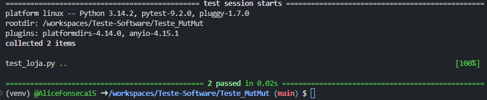
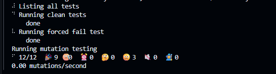
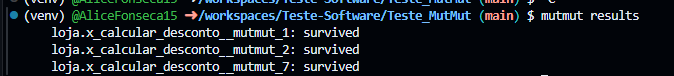
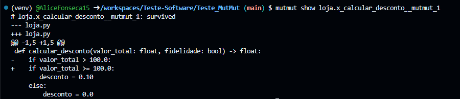
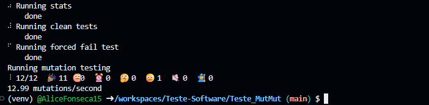

## Evidências do teste de mutação com Mutmut

### Etapa 1: Execução dos testes

Os testes foram executados com `pytest`. Na captura, os dois testes existentes passaram.

### Etapa 2: Execução do Mutmut

O comando `mutmut run` gerou e avaliou 12 mutantes. Na execução registrada, nove foram eliminados pelos testes e três sobreviveram.

### Etapa 3: Listagem dos mutantes sobreviventes

O comando `mutmut results` listou os três mutantes sobreviventes da execução.

### Etapa 4: Inspeção de um mutante

O comando `mutmut show loja.x_calcular_desconto__mutmut_1` exibiu as alterações feitas pelo mutante. Neste caso, a comparação `valor_total > 100.0` foi alterada para `valor_total >= 100.0`. Como o mutante sobreviveu na execução registrada, os testes executados naquele momento não detectaram essa alteração.

### Etapa 5: Reexecução com os testes atualizados

Para evitar que o Mutmut reutilize resultados antigos após mudanças nas dependências, foi configurado `on_dependency_change = rerun` no `setup.cfg`. Na nova execução, os 12 mutantes foram reavaliados: 11 foram eliminados pelos testes e um continuou sobrevivendo.

